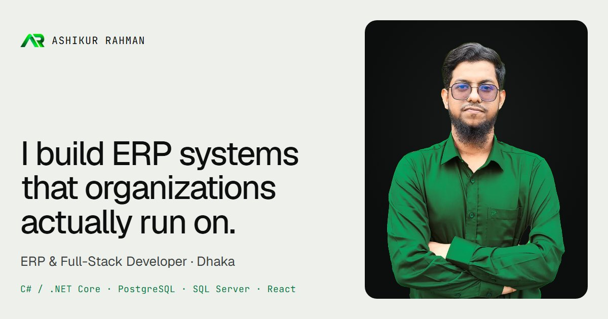
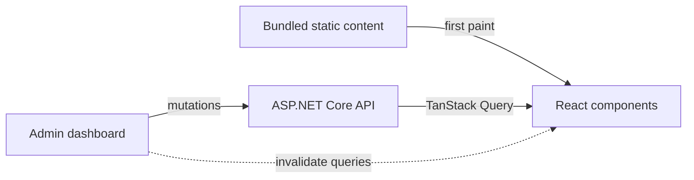

# Ashikur Rahman — Portfolio (Frontend)

The frontend of my developer portfolio: a React 19 + TypeScript single-page app that presents the
ERP systems I build, a technical blog, and an admin dashboard for managing all of it.

It talks to a separate ASP.NET Core Web API: **[Portfolio-API](https://github.com/AshikurWebDev/Portfolio-API)**.



## Contents

- [Highlights](#highlights)
- [Tech stack](#tech-stack)
- [Features](#features)
- [How it is built](#how-it-is-built)
- [Project structure](#project-structure)
- [Getting started](#getting-started)
- [Environment variables](#environment-variables)
- [Scripts](#scripts)
- [Security](#security)
- [Accessibility and performance](#accessibility-and-performance)
- [Deployment](#deployment)

## Highlights

- **Static-first, API-enhanced.** Every page renders at once from bundled content; live data from the
  API replaces it when it arrives. If the API is slow or down, the site still works.
- **Live updates.** When content changes in the admin, every open copy of the site refetches it over
  SignalR, with no reload.
- **Admin dashboard** behind Google sign-in: overview, posts, skills (with percentages and logos), CV,
  design gallery, contact messages and AI-agent tokens.
- **Motion with restraint.** GSAP scroll animations, a pinned four-layer "How I build" story and a
  lazy-loaded three.js scene, all switched off for reduced-motion users, data savers and weak devices.
- **Built for review.** TypeScript strict mode, one source of truth for API shapes, comments that
  explain *why*, and a documented design system ([DESIGN.md](DESIGN.md)).

## Tech stack

| Area | Technology |
|------|------------|
| Framework | React 19, TypeScript, Vite |
| Data | TanStack Query (caching, placeholder data, cache invalidation from the admin) |
| Live updates | SignalR client (`@microsoft/signalr`, loaded when the page is idle) |
| Animation | GSAP + ScrollTrigger, Lenis smooth scroll |
| 3D | three.js via React Three Fiber (lazy-loaded) |
| Content | react-markdown, remark-gfm, rehype-highlight (highlight.js) |
| Icons | Simple Icons (CC0) for skill logos, hand-drawn SVGs where no brand icon exists |
| Fonts | Geist and JetBrains Mono, self-hosted (no third-party font requests) |
| Lint | oxlint |
| Hosting | Docker image with Caddy (static files, reverse proxy, automatic HTTPS) |

## Features

### Public site

| Section | What it shows |
|---------|---------------|
| Hero | Name, role and a 3D ERP model on a dark stage; a short first-visit intro animation |
| Intro | Who I am, current status and key numbers |
| Systems | Systems I designed and built, each with its real status (live, in development) |
| AI-powered ERP | Concept demos of AI agents working inside ERP role checks |
| How I build | A pinned scroll story through the four layers: interface, API, business logic, data |
| Skills | Cards of skills with levels and small flat logos |
| Design gallery | Educatory design work in justified rows: every image keeps its own aspect ratio; click to open a lightbox |
| About, Experience | Background, training and work record |
| Notes (blog) | Markdown posts filed by system layer, with numbered diagrams and a reading rail |
| Contact | Two forms (job role or project brief), saved through the API; email fallback without it |

"Download CV" buttons serve the PDF uploaded in the admin and hide themselves when none is uploaded.

### Admin dashboard (`/admin`)

| Page | What you can do |
|------|-----------------|
| Overview | See published posts, drafts, skills, design items, unread messages and CV status |
| Posts | Write Markdown with live preview, publish, unpublish, delete |
| Skills | Add, rename, reorder and delete cards; set each skill's percentage, logo and note |
| CV | Upload, replace, download or delete the CV PDF |
| Design | Upload images (compressed to WebP by the API), edit captions, reorder, hide, delete |
| Messages | Read contact form messages |
| AI agent access | Create and revoke tokens for AI agents that draft posts through the API's MCP server |

Every delete opens a confirmation modal; every save or delete shows a notification
(green for success, red for deletions) that closes after 3 seconds.

## How it is built

### Data flow



- `src/data/api.ts` holds every public API call. Each loader falls back to the static content in
  `src/content/` when the API is not configured, fails, or takes longer than 4 seconds.
- `src/data/queries.ts` wraps the loaders in TanStack Query hooks with the static content as
  placeholder data, so components never show an empty loading state.
- Admin mutations (`src/admin/queries.ts`) invalidate both the admin and the public query keys, so a
  change in the dashboard appears on the site straight away.
- Types in `src/types/content.ts` mirror the API's DTOs.
- `src/lib/live.ts` opens a SignalR connection to the API's `/hubs/site` once the page is idle. The API
  sends `contentChanged("design" | "skills" | "cv" | "posts")` after any change; the page invalidates the
  matching query and TanStack Query refetches it. The connection reconnects on its own and refetches
  everything after a reconnect, in case a message was missed.

### Design gallery layout

Justified rows in pure CSS: each item's `flex-basis` is its aspect ratio × a target row height and its
`flex-grow` is the ratio, so images in a row share one height and the row fills the width without
cropping. A filler element keeps a short last row at the target height.

### Routing

A small client router (`src/lib/router.tsx`) handles `/`, `/blog`, `/blog/:slug` and `/admin/*`.
The admin is code-split so visitors never download it.

### Animation and 3D

- GSAP timelines are created inside `useGSAP` so they clean up with the component.
- Where data can change after first paint (skills), the animated grid is keyed by a data signature,
  so GSAP never writes into DOM nodes React is about to reuse.
- The three.js scene loads lazily and is skipped on reduced motion, data saver and low-power devices.

## Project structure

```
src/
├── components/   Home page sections (Hero, Systems, Skills, …), Header, Footer
├── blog/         Blog index and post pages, Markdown renderer, layer rail, figures/
├── admin/        Dashboard: Overview, Posts, Skills, CV, Design, Messages, Agent access,
│                 Feedback.tsx (confirm modal + notifications), client.ts (auth-aware fetch)
├── data/         api.ts (API + fallback), queries.ts (hooks), queryClient.ts (keys, defaults)
├── content/      Static content: profile, projects, skills, posts, drafts (dev only)
├── lib/          router, SEO helpers, skill logos, device and motion checks
├── hooks/        Smooth scroll, navigation helpers
├── styles/       tokens.css (design tokens), global.css
└── types/        Shared content types (mirror the API)
public/           Images, logo, social preview image
vite-plugin-seo.ts  Build-time JSON-LD, canonical links, robots.txt and sitemap.xml
Dockerfile, Caddyfile  Production image (see Deployment)
```

## Getting started

Requirements: Node.js 20 or newer.

```bash
git clone https://github.com/AshikurWebDev/Portfolio-Web.git
cd Portfolio-Web
npm install
cp .env.example .env     # optional: leave VITE_API_URL empty to run on static content only
npm run dev              # http://localhost:5173
```

To use the admin dashboard and live data, run the API from
[Portfolio-API](https://github.com/AshikurWebDev/Portfolio-API) on port 5180 and set
`VITE_API_URL=http://localhost:5173` in `.env`. The Vite dev server proxies `/api` to the API, so the
site and API share one origin and the refresh-token cookie works.

## Environment variables

| Variable | Purpose |
|----------|---------|
| `VITE_API_URL` | Base URL of the API. Empty = static content only. In development: `http://localhost:5173` (proxied). |
| `VITE_SITE_URL` | Live site origin, e.g. `https://example.com`. Used for canonical links, Open Graph URLs, JSON-LD and the sitemap. |
| `VITE_GOOGLE_CLIENT_ID` | Google OAuth client id for admin sign-in. Public by design; the API verifies every token. |

All three are read at build time. `.env` is git-ignored; only `.env.example` is committed.

## Scripts

| Command | What it does |
|---------|--------------|
| `npm run dev` | Development server with hot reload |
| `npm run build` | Type-check (`tsc -b`) and build into `dist/` |
| `npm run preview` | Serve the production build locally |
| `npm run lint` | Lint with oxlint |

## Security

- **No secrets in the bundle.** Only public values (`VITE_*`) reach the browser.
- **Tokens:** the admin access token lives only in memory, never in `localStorage`. The refresh token is
  an `HttpOnly`, `Secure`, `SameSite=Strict` cookie that scripts cannot read.
- **CSRF:** admin requests send the token in an `Authorization` header, which browsers never attach
  on their own.
- **XSS:** React escapes all output; Markdown renders without raw HTML; skill logos come from a fixed
  map in the code, never from markup stored in the database.
- **Sign-in:** Google Identity Services only. The API checks the token and an email allowlist.
- **Headers (production):** Caddy sends `X-Content-Type-Options: nosniff`, `X-Frame-Options: DENY`
  and a strict referrer policy.

## Accessibility and performance

- Text contrast meets WCAG AA; every interactive element has a visible focus outline.
- `prefers-reduced-motion` turns off scroll animations, pulses and the intro.
- The confirm modal is a native `<dialog>`: focus stays inside, Esc cancels, and Cancel is focused first.
- Fonts are self-hosted; the 3D scene and the admin are lazy-loaded; build files are hashed and
  cached for a year, while `index.html` is always revalidated.
- SEO: Open Graph and Twitter tags, JSON-LD (Person, WebSite, BlogPosting), canonical links,
  `robots.txt` (blocks `/admin`) and `sitemap.xml`.

## Deployment

`Dockerfile` builds the site with Node and packs `dist/` into a Caddy image. `Caddyfile` serves the
files with an SPA fallback, proxies `/api`, `/mcp` and `/health` to the API container, sets cache
headers and obtains HTTPS certificates automatically.

The full stack (PostgreSQL, API and this image) is started with Docker Compose from the backend
repository. Step-by-step VPS guide: [Portfolio-API/deploy](https://github.com/AshikurWebDev/Portfolio-API/tree/main/deploy).

## Author

**Ashikur Rahman** — ERP and full-stack developer, Dhaka

- GitHub: [AshikurWebDev](https://github.com/AshikurWebDev)
- LinkedIn: [Ashikur Rahaman](https://www.linkedin.com/in/ashikur-rahaman-6082831a2/)
- Email: ashik.cu.ges@gmail.com
